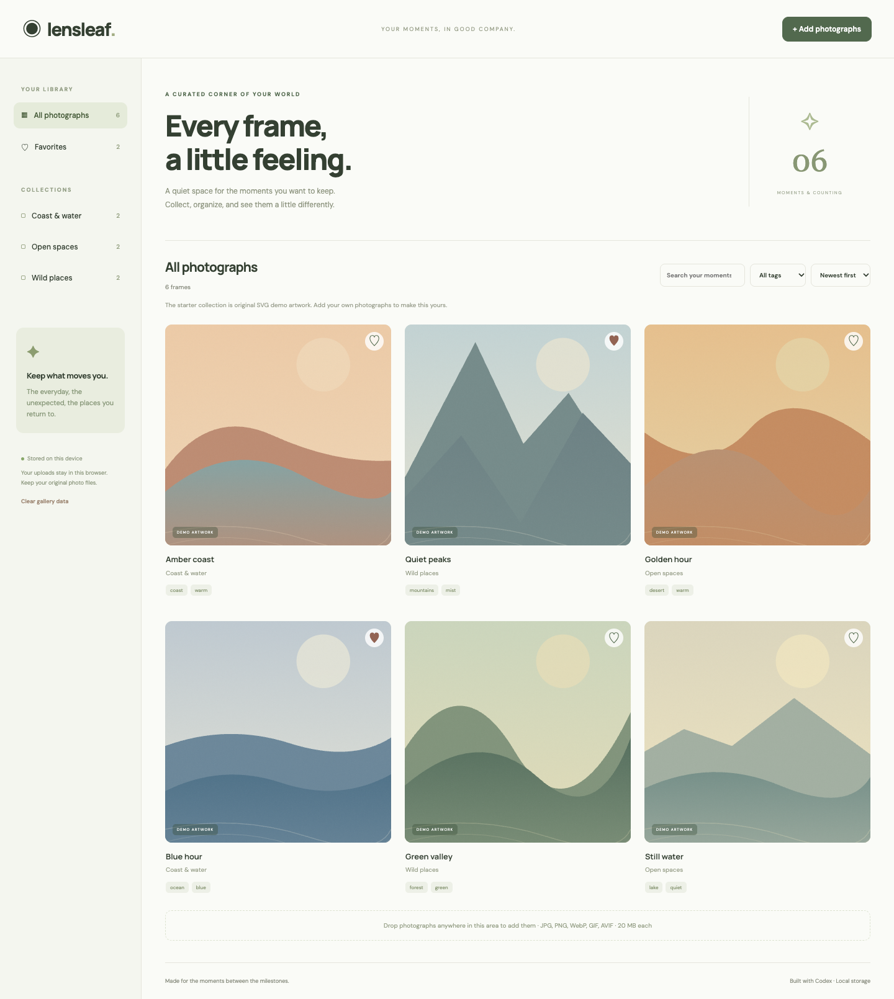

# Lensleaf

[Open live app](https://mohdriyaazpersonal.github.io/lensleaf/)



A responsive personal photo gallery with image uploads, collections, tags, search, favorites, editable metadata, sorting, drag-and-drop upload, and a keyboard-controlled lightbox. Six original local SVG landscape illustrations provide a clearly labeled demo collection; no private photos or external photo services are used.

## Run and verify

Node.js 22+; no package dependencies.

```sh
npm start
npm test
npm run build
```

Open the localhost URL printed by the server. `dist/` is a portable static website. Tests cover file validation, tag normalization, and combined filters.

## Use and storage

Add JPEG, PNG, WebP, GIF or AVIF images up to 20 MB each, with a maximum of 500 gallery entries. Images are decoded before saving and stored as Blobs in **IndexedDB**, not localStorage. Uploads are never sent to a server. Collections and tags are editable in the image viewer. Arrow keys navigate the current filtered collection; Escape closes the viewer. Delete removes an individual item, while Clear gallery data removes every locally stored item. Original files on your computer are unchanged.

Storage belongs to the browser and site origin. It is not encrypted or a backup, may be evicted, and is not synced across devices. Keep your original image files. Changing localhost ports creates a different storage origin. Browser storage quota failures are reported. Unsupported or disabled storage leaves a read-only demo gallery. Google Fonts is optional with system-font fallback.

## Mission context

Built with Codex, inspired by [Build a Personal Photo Gallery](https://app.joinhandshake.com/learn/build-a-personal-photo-gallery-ade67847). The original mission requires Figma design, reusable cards, annotations, Figma Make, personal photos and publication. This independent gallery does not claim to have completed the Figma workflow or a Handshake submission.
